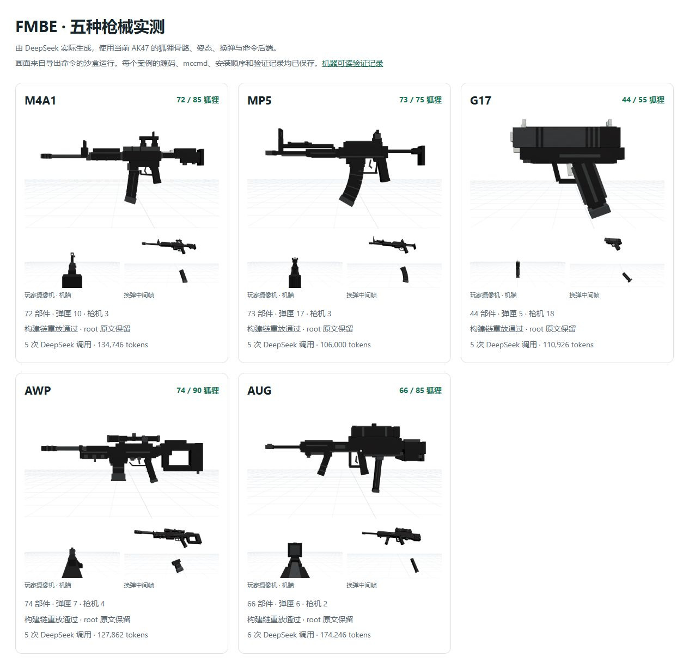

# FMBE Studio

面向网易基岩版 1.21.120 技术基线的本地 FMBE 造型与命令工作台，包含枪械模式、白色背景预览及 DeepSeek 生成接口。

这是在自己的电脑运行、用浏览器操作的程序。无需部署网站即可使用。

## 下载与启动

1. 从 [Releases](https://github.com/izowifar074-bot/fmbe-studio/releases/latest) 下载 **FMBE-Studio-0.2.1.zip**。请选择完整程序附件，不是 GitHub 自动生成的 Source code。
2. 安装 [Node.js 22 或更高版本](https://nodejs.org/)。
3. 解压后双击 **启动 FMBE Studio.cmd**。
4. 浏览器打开 <http://127.0.0.1:18120>。停止时双击 **停止 FMBE Studio.cmd**。

完整程序附件包含构建产物、运行依赖、离线资源与示例。查看和编辑已有模型、动作预览及导出命令不需要配置 AI。

## AI 枪械模式

在“枪械”中输入“制作……枪械”，并填写自己的 DeepSeek API 密钥。官方接口使用 `deepseek-flash`；密钥只保存在本机服务进程内存，重启后需重新填写，不随工程或导出包保存。

模型负责部件造型；编译器负责实体预算、狐狸编号、骨骼变换、姿态和换弹绑定。模型可根据编译错误与预览反馈修正作品。

## 已附示例

| 枪型 | 狐狸数量 |
| --- | ---: |
| AK47 参考 | 75 |
| M4A1 | 72 |
| MP5 | 73 |
| G17 | 44 |
| AWP | 74 |
| AUG | 66 |

五种 DeepSeek 案例的工程在 `examples/gun-*-deepseek/project.json`，可通过“打开工程”载入。Release 另附独立命令包 `FMBE-gun-examples-0.2.1.zip`。



## 文档与验证

- [使用说明](docs/local-usage.md)
- [枪械模式](docs/gun-mode.md)
- [HTTP API](docs/api.md)
- [需求核对与证据范围](docs/gun-mode-audit.md)
- [原存档与转换问题澄清](docs/source-vs-export.md)

46项自动测试通过。程序依据当前 AK47 命令基线工作；详细兼容范围见文档。本程序不是完整的基岩客户端模拟器。

## 从源码开发

```sh
npm ci
npm run typecheck
npm run build
npm test
npm start
```

本地工程和历史写入 `data/`，该目录不纳入 Git。公开发布包不包含 API 密钥、本机运行日志或个人工程历史。

## 第三方资源

Minecraft相关素材与第三方依赖各自保留其权利和适用条款，见 [THIRD-PARTY-NOTICES.md](THIRD-PARTY-NOTICES.md) 及 `assets/licenses/`。
